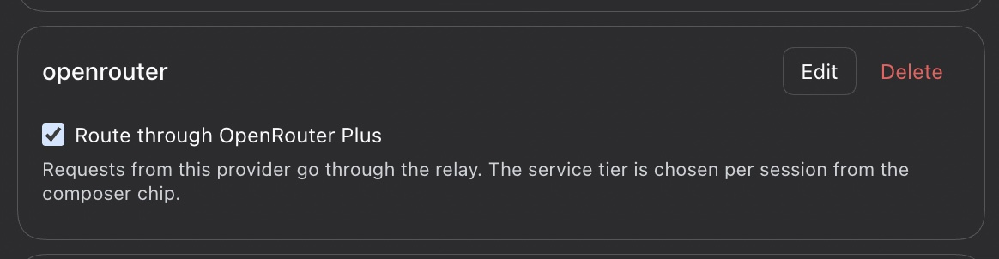
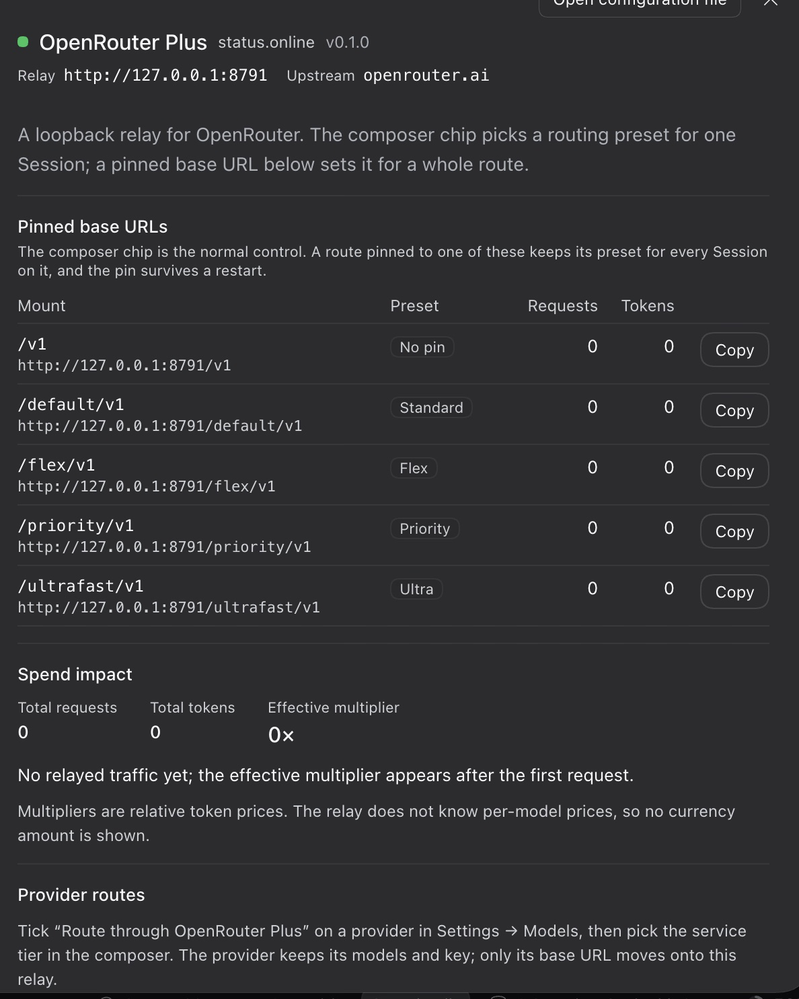
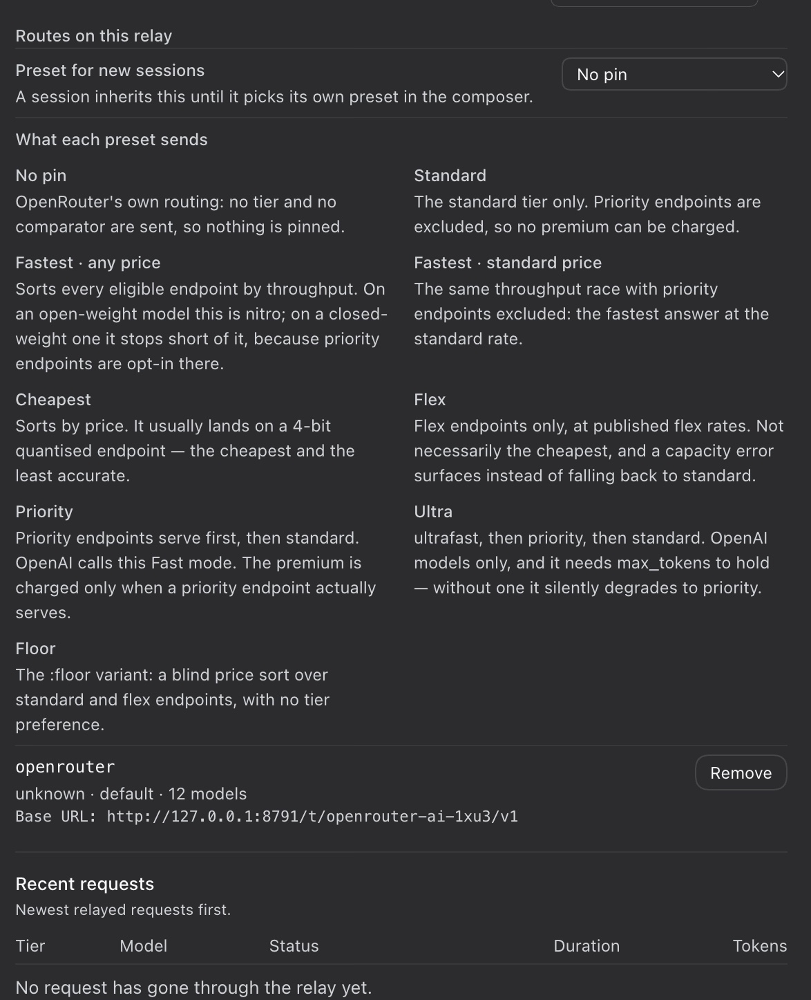
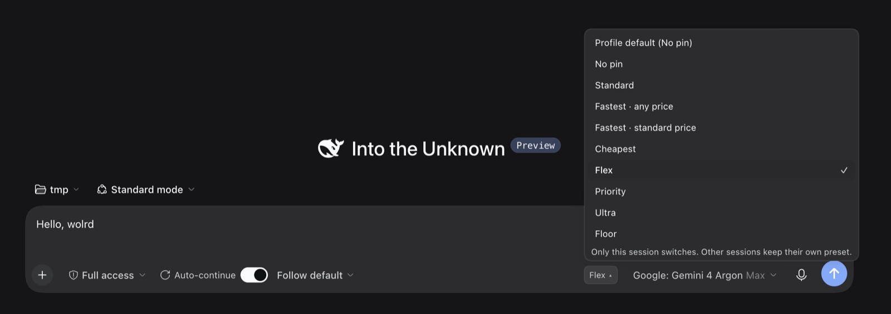
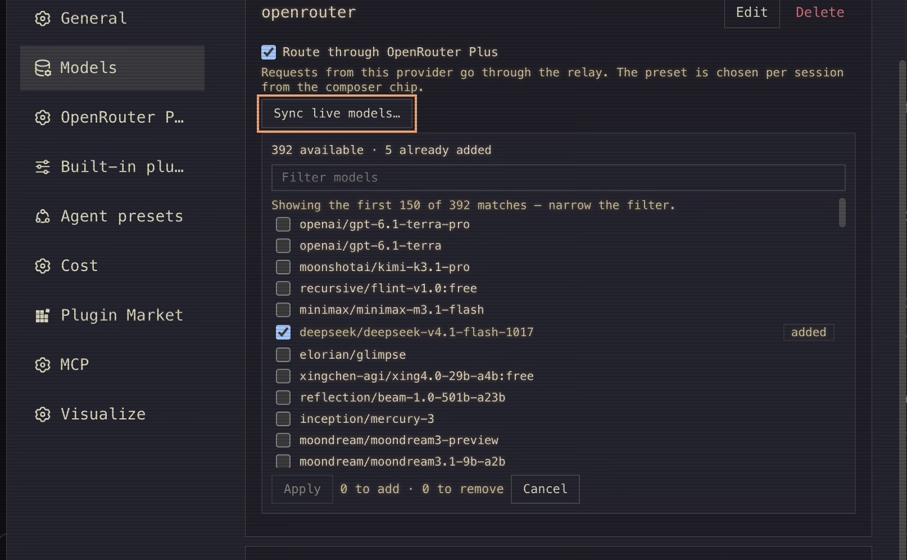

# dsh-openrouter-plus

[](https://www.npmjs.com/package/dsh-openrouter-plus)
[](LICENSE)

**Service-tier routing *and* a live model list for OpenRouter — as a DeepSeek Harness plugin, with
no patched packages.**

DSH's OpenRouter support has two gaps, and neither one is reachable from a provider profile.

**Routing.** OpenRouter lets you steer where a request is served from: `flex` endpoints bill half
price on a slower pool, `priority` endpoints bill a multiplier for lower latency, and the throughput
or price comparators reorder the pool in between. `@deepseek-ai/dsh-llm-pi-ai` exposes `baseURL` and
`headers` on a provider profile, but no request-body fields
([discussion #9787](https://github.com/deepseek-ai/deepseek-harness/discussions/9787)).

**Model discovery.** *Fetch available models* is answered from the catalog baked into
`@earendil-works/pi-ai`, and for a catalog-backed route (`openrouter`) it answers **before** it reads
that route's `baseURL`. The snapshot only refreshes when pi-ai is published again, so every model
OpenRouter has added since then is invisible — on the build this plugin was written against, that was
**65 of OpenRouter's 463 live models**, including `openai/gpt-6.1-terra`,
`moonshotai/kimi-k3.1-pro` and `x-ai/grok-4.20-multi-agent`. Pointing the row at another endpoint
does not help: the provider *name* is what short-circuits, not the URL.

This plugin closes both gaps from the outside, and it never patches a shipped package. A **loopback
relay** applies the routing preset to each request. **Sync live models** reads the endpoint a route
points at and lists it, so you can tick the models you want and add just those. Both ride on schema
fields the profile already has, so both survive `bun install -g` upgrades and never touch
`~/.bun/install/global`.

The preset is chosen **per session, at request time**. One provider row keeps serving every preset, so
switching never mints a provider, a route or a model list.

```
  composer chip: this session runs on «priority»
      │
      ▼
  dsh-llm-pi-ai ──►  dsh-openrouter-plus relay  ──►  https://openrouter.ai/api/v1
      baseURL =           │ reads the session from x-session-id / prompt_cache_key,
  127.0.0.1:8791/t/<id>/v1  │ applies that session's preset to the body
                            └── /__openrouter-plus/* ──► OpenRouter Plus settings page
                                  ├ /models      reads the live listing
                                  └ /models/add  adds only the ticked models
```

## What you get

- **Sync live models.** A provider row routed through OpenRouter Plus also gets a **Sync live
  models…** button. It reads the endpoint that row points at and shows what it publishes *right
  now* — including models added after the pi-ai catalog in your install was generated — with a
  filter box and a checkbox per model. Tick what you want and only those are added; models the
  route already declares are marked `added` and cannot be added twice. Nothing is rewritten:
  hand-written names, context windows and effort maps are left exactly as they are. A row that is
  not routed shows the switch alone: the button belongs to the opt-in, not to every `llm-pi-ai` card.
- **One provider row, any preset.** A routed provider keeps its key, protocol and models and gains
  one thing: a composable **preset** that the relay applies to each request. No per-preset provider
  copies, no sibling route per preset, no model list duplicated nine times.
- **Pinned base URLs** for what a chip cannot cover — `/v1` (no pin), `/default/v1` (Standard),
  `/flex/v1` (Flex), `/priority/v1` (Priority), `/ultrafast/v1` (Ultra). Paste one into an
  OpenAI-compatible provider route and that preset applies to *every* Session on the route,
  subagents included, and survives a restart. The relay still serves the older names
  (`/auto/v1`, `/fast/v1`, `/scale/v1`); the settings page lists one mount per preset so it never
  offers the same choice twice.
- **Its own settings page** (Settings → OpenRouter Plus) showing relay state, one pinned base URL
  per preset with a copy button, live request/token counters per preset, the measured effective
  multiplier, spend in USD (today, the retained window, cost per preset), and recent requests.
  The same page is the bundle's body on its Plugins card
  (Plugins → Installed → OpenRouter Plus, in the sidebar's plugin manager), beside the version and
  the Uninstall button — so the plugin is configurable from where it was installed, not only from
  the nav row it added.
- **A preset chip in the composer** — next to the model selector, a compact chip shows the preset
  this Session will actually apply and switches it in one click. The switch is **per session**: it
  changes what the next request from *this* conversation carries, so two conversations can sit on
  `Flex` and `Priority` at the same time. It shows up on a brand-new Session too — before the first
  message the chip reads the profile default, so a preset can be picked *before* you start typing.
  The reasoning effort you chose stays put: switching a preset touches no provider row and no model
  list.
- **A switch on every provider row** — in Settings → Models, each `llm-pi-ai` provider gets a
  **Route through OpenRouter Plus** checkbox. Tick it and that provider's traffic flows through the
  relay to the endpoint you already gave it; untick it and the endpoint comes back. Your provider
  entry, protocol, key and models are left exactly as they were.
- **A default preset for the profile** — the settings page sets what an unchosen Session inherits
  (and explains what every preset sends), and the composer chip's `Profile default (…)` entry hands
  a Session back to it.
- **Zero risk to your existing setup** — the relay holds no API key, forwards your `Authorization`
  header verbatim, binds only to loopback, and the only profile changes it makes are reversible by
  construction.

## Spend: what it actually cost

The relay reports the **billed amount**, not a token count multiplied by a price list. Each response
carries `usage.cost` (plus `cost_details` for BYOK's upstream charge and server tools), and the relay
copies it out of a bounded head/tail while forwarding the bytes untouched. That amount already
reflects *which endpoint served the request* — flex at half price, priority/ultrafast at a premium,
a `:floor` variant, or a fallback that answered with another model — which is exactly the
information a price table cannot reconstruct afterwards.

Cost is bucketed by **local calendar day** and kept for **14 days**, so a Host restart does not reset
today's number; token counters and the last-50-requests ring are process-local and do start over. A
`null` means the provider reported nothing (failed call, aborted stream) and is never shown as `$0`;
a `0` is a genuinely free call. BYOK keeps two separate bills: `costUsd` is OpenRouter's charge,
`upstreamCostUsd` is your provider's own.

Read [`docs/USAGE.md`](docs/USAGE.md) for the field-by-field contract, the window and persistence
rules, and what a reload keeps.

## Screenshots

The switch lives on the provider you already use, in Settings → Models. Ticking it moves that
row's traffic onto the relay and changes nothing else:



The settings page — relay state, one pinned base URL per preset, the counters, and what each
preset actually sends:





The composer chip, which switches the preset for one Session without touching any provider row:



A routed provider row also carries **Sync live models…**: it lists what that row's endpoint publishes
right now, ticked where the route already has the model, so you can add a model or untick one
without touching anything else. Hand-written entries are never rewritten.



## Install

`--profile` is not optional — `dsh plugin` manages the plugins of one named profile, so pass the
one you actually boot (`web` for `dsh web`, `default` for a bare `dsh`). Without it the CLI stops
with `required option '--profile <name>' not specified`.

```bash
dsh plugin --profile web add dsh-openrouter-plus                              # from npm
dsh plugin --profile web add github:GnaneshKunal/dsh-openrouter-plus#v0.1.0   # or a pinned tag
```

From a clone, which is what development uses:

```bash
git clone https://github.com/GnaneshKunal/dsh-openrouter-plus
dsh plugin --profile web add ./dsh-openrouter-plus     # or, from a session:
#   plugin_manager { action: install_bundle, target: "./dsh-openrouter-plus" }
```

The manifest declares `engines.dsh`, so the plugin manager refuses a harness older than the build
it was tested against instead of mounting something that cannot work.

The plugin adds one entry to Settings navigation: **OpenRouter Plus**, directly after *Models*. If
the relay is up, the page shows the origin (`http://127.0.0.1:8791`) and its mounts.

It also fills the body of its own card under **Plugins → Installed**, the plugin manager in the main
sidebar (not *Settings → Built-in plugins*, which only lists component status). Both seats render the
same page, so there is one place to learn the relay state and one place to change it — pick whichever
you were already in. The Plugins card additionally carries the installed version, the rows the bundle
declares, the npm source and the uninstall button.

## Releasing

`.github/workflows/ci.yml` runs `npm run check`, `npm test` and `npm pack --dry-run` on every push
and pull request. `.github/workflows/release.yml` turns a tag into a release:

```bash
$EDITOR package.json CHANGELOG.md      # version 0.2.0, and a "## [0.2.0] — 2026-11-02" section
git commit -am "chore: 0.2.0" && git push
git tag v0.2.0 && git push origin v0.2.0
```

The job refuses a tag that disagrees with `package.json`, runs the suite, publishes to npm, and
opens the GitHub Release with the matching `CHANGELOG.md` section as its notes. It fails rather
than skipping when npm already has that version: a release is a new version, never a re-upload.

npm needs the package to exist before it can trust a publisher, so `0.1.0` went up by hand, once,
from a logged-in machine:

```bash
npm login
npm publish --access public
npm trust github dsh-openrouter-plus --file release.yml \
  --repo GnaneshKunal/dsh-openrouter-plus --env release --allow-publish
```

Every version after it is a tag, and nothing else. The tag does everything: the workflow run's OIDC identity is accepted, npm attaches a
provenance attestation linking the tarball to the commit and run that built it, and no
`NPM_TOKEN` exists in the repository. `npm trust list dsh-openrouter-plus` shows the grant.

Publishing to npm is optional for users: `dsh plugin --profile web add github:…` installs the same code from a
tag, which is how most of the community ships.

## Use it

### Two clicks: tick the provider, pick the preset

1. **Settings → Models** → tick **Route through OpenRouter Plus** on the provider you already use
   (for example `openrouter-custom`). That provider's traffic now flows through the relay; its
   `api`, `apiKeyEnv`, headers and models are untouched.
2. Open the composer of any Session and pick a preset in the chip next to the model selector. Every
   request that Session sends now applies that preset.

Nothing else to create, and nothing to clean up: the provider row is the only row that ever existed,
and the preset is a per-Session choice rather than a provider.

The settings page manages the profile-level **Service tier for new sessions** — with a short table
of what each preset sends — and lists the routes that currently point at this relay (with **Remove**
for the ones you no longer want).

### From a provider row (the switch)

In **Settings → Models**, every `llm-pi-ai` provider row carries a compact strip added by this
plugin: a **Route through OpenRouter Plus** checkbox.

Ticking it does three things, all through the control API:

1. records the endpoint that row currently points at (that is your real base URL) as a *target* in
   this plugin's own config;
2. gives that target a mount — `http://127.0.0.1:8791/t/<targetId>/v1` — which *mounts* the
   endpoint without pinning a service tier: the presets come from the Sessions that call it;
3. repoints **only** that provider row's `baseURL` at the mount. `api`, `apiKeyEnv`, headers and
   models are not touched, and no plugin bookkeeping is written into the provider entry (it is
   schema-validated, so it stays clean).

**The first attach reloads the plugin.** Recording a new target is a write to this plugin's own
config, so the Loader re-applies the Host row and the listener rebinds — which can cut the HTTP
response to that very request. It is not a failure: the strip re-probes `/health`, re-reads
`/targets` and shows the truth, and every write here is idempotent, so a retry lands cleanly. Later
attaches (a detach, a re-attach of a known endpoint) reuse the target row and do not reload anything.
**A preset switch never writes anything**, so it never reloads anything either.

What happens to a request: the relay strips the mount prefix, appends the rest of the path to your
recorded endpoint, resolves the preset the Session carrying that request chose, and applies it to the
JSON body. `No pin` sends neither a tier nor a comparator — and a `service_tier` the client put there
itself is removed, so a Session that pinned nothing stays unpinned rather than inheriting whatever a
UI happened to send.

Untick it (**Detach**) and the row's `baseURL` goes back to the endpoint recorded for that target;
the mount stays until you remove the target. Everything is idempotent: the same endpoint always maps
to the same target id, so ticking the box twice cannot fork the table or repoint anything twice.

> **Why the switch is on the row and not inside the add-provider form.** The obvious place for this
> checkbox is the "Custom model API" form itself. A plugin cannot put it there: the
> `settings.models.provider-card` extension slot hands an extension `{provider, configured,
> keyConfigured}` and no setter, the draft Base URL lives in a private `useState` inside the editor,
> and that card dispatches no extension at all before the provider is saved. The saved row is the
> earliest surface a plugin can reach — same page, one save later. The same class of limitation is
> why a re-picked model loses hand-declared fields (tracked upstream as
> [discussion #11097](https://github.com/deepseek-ai/deepseek-harness/discussions/11097)).

### By hand

Point any OpenAI-compatible provider route's `baseURL` at a mount:

```yaml
- id: llm-pi-ai
  config:
    providers:
      my-flex-route:
        api: openai-responses
        apiKeyEnv: OPENROUTER_API_KEY
        baseURL: http://127.0.0.1:8791/flex/v1
        models:
          - id: deepseek/deepseek-v4.1-flash
            # Optional but recommended — see "Reasoning effort" below.
            reasoningEfforts:
              off: null
              low: low
              medium: medium
              high: high
              max: max
```

Or route a provider to its own endpoint through a target mount — no provider config needed beyond
the base URL:

```yaml
- id: llm-pi-ai
  config:
    providers:
      acme-gateway:
        api: openai-completions
        apiKeyEnv: ACME_API_KEY
        baseURL: http://127.0.0.1:8791/t/acme-gw-9f3a/flex/v1
        models:
          - id: acme-large
```

`/t/<targetId>/v1` is the shape the switch writes: it mounts the endpoint and pins nothing, so each
Session's chip decides. `/t/<targetId>/<tier>/v1` is the older pinned shape and still works — useful
when a row must sit on one tier regardless of who calls it. The target's endpoint is declared once,
in the plugin's config (see `targets` below), so one listener can front any number of OpenAI- or
Anthropic-style endpoints.

### Reasoning effort on a relay route

A relay route is a provider key the installed catalog has never seen, so
`@deepseek-ai/dsh-llm-pi-ai` cannot inherit a model's reasoning capability for it. Without an
explicit `reasoningEfforts` the model materializes as `reasoning: false` and the composer shows
**"This model provides no reasoning effort levels."** — no effort selector, no error, nothing in the
log. The relay itself is not involved; it never touches reasoning fields.

The plugin fills that gap when it creates a route, from the best evidence available:

1. a capability the model already declares (in the source route), kept byte-identical;
2. a declaration for another variant of the same id — `google/gemini-4-argon:flex` teaches the
   plugin about `google/gemini-4-argon`;
3. the configured `reasoningEfforts` map, as a fallback for everything else.

Set `reasoningEfforts: false` to switch filling off, or omit it to fill only from evidence 1–2.
A model that declares `reasoningEfforts: false` is itself opted out: the fill leaves it alone.

**The fill also re-applies itself.** Re-picking a model in Settings → Models rebuilds that row from
the catalog — `id`, `name`, context window, max tokens — and drops `reasoningEfforts` along with
every other hand-declared field. That is the shape of this bug: the effort selector works, you touch
the model list afterwards, and it is gone. The cause is upstream rather than here (`adopt()` in
`@deepseek-ai/dsh-client-ui-settings-models` copies a fixed field list), so the plugin watches the
profile instead: a debounced pass runs on every config settle and restores the capability a moment
after the edit lands. Set `autoRepairReasoning: false` to keep the plugin out of your config
entirely, and use **Add reasoning to N models** in the settings page (or
`POST /__openrouter-plus/routes/repair`) when you want the fill on demand.

Either way it only ever touches routes whose `baseURL` points at the relay, never overwrites a
declared map, never resurrects an explicit `false`, and writes nothing when there is nothing to do.

## Presets

A service tier is not one field. OpenRouter exposes three levers — `service_tier` (which pools may
serve, and in what order), `provider.sort` (the comparator over that pool) and two slug suffixes
(`:nitro`, `:floor`) that mix the two — and each preset is a combination the API actually defines:

| Preset | Sends | What it does |
| --- | --- | --- |
| **No pin** | nothing | OpenRouter's own routing. |
| **Standard** | `service_tier: "default"` | The standard tier only; priority endpoints are excluded. |
| **Fastest · any price** | `provider.sort: "throughput"` | The whole eligible pool sorted by throughput. On an open-weight model this *is* nitro — its priority endpoints already compete in default routing. On a closed-weight one it stops short, because those endpoints are opt-in. |
| **Fastest · standard price** | `sort: "throughput"` + `service_tier: "default"` | The same race over the standard pool only, so the priority premium is unreachable. |
| **Cheapest** | `provider.sort: "price"` | Lowest price over the standard pool — usually a quantized version of the model. It never admits a flex endpoint, so it cannot reach a flex rate. |
| **Flex** | `service_tier: "flex"` | Flex endpoints only, at flex rates. Not necessarily the cheapest, and a flex capacity error surfaces instead of falling back to standard. |
| **Priority** | `service_tier: "priority"` | Priority endpoints serve first, then standard. OpenAI calls this Fast mode. The premium is charged only when a priority endpoint actually serves, and within each group endpoints sort by throughput unless you set a comparator. |
| **Ultra** | `service_tier: "ultrafast"` | ultrafast, then priority, then standard. OpenAI models only, and it needs `max_tokens` to hold — without one it silently degrades to priority. |
| **Floor** | `model: "…:floor"` | A blind price sort across the standard **and** flex pools. No parameter form exists for this, which is why it is a slug. `:nitro` is deliberately not offered separately: for the models where it changes the outcome, **Fastest · any price** is the same race. |

Two rows sit between "no tier" and "priority" for a reason: `provider.sort` and `service_tier`
decide different things. Sorting by throughput reorders whatever pool the tier admitted; pinning
`service_tier: "default"` is what keeps the premium out of it. Neither one alone can say
"fastest, and never at a premium".

### What a sort costs you: Auto Exacto

OpenRouter's [Auto Exacto](https://openrouter.ai/docs/guides/routing/auto-exacto) runs by default on
every request that carries tools — which, for an agent, is every request. It reorders the providers
of the chosen model using measured tool-calling success rate, throughput and benchmark scores, per
endpoint.

**Any explicit `provider.sort` disables it, and so does the `:floor` slug.** That splits this
plugin's ladder in two:

| Auto Exacto still runs | Auto Exacto is bypassed |
| --- | --- |
| No pin, Standard, Flex, Priority, Ultra | Fastest (both), Cheapest, Floor |

So the two cheapest presets buy a compressed endpoint *and* switch off the platform's quality
ordering. That is a legitimate trade; it should just not be a silent one — which is why the precision
floor exists, and why the settings page says it next to the picker.

### From the composer (the Tier · Precision chip)

Once a provider row is routed, a compact chip appears in the composer next to the model selector,
showing the preset the next request will apply — and, once you have chosen one, a precision floor:
`Cheapest · ≥8-bit`. Picking another one there does **not** rewrite any config and does **not** mint a
provider: the Host records the choice for this Session in memory, and the relay applies it to the
request body on the way out.

The chip opens the same two-level menu the composer's own model picker uses for **Model** and
**Effort**: two rows, each showing its current value and opening its own list when pressed.

- **Tier** — the presets: `Fastest · any price`, `Cheapest`, `Flex`, `Priority`, … The first entry,
  **Profile default (…)**, stops choosing for this Session and shows which preset it will inherit.
- **Precision** — `Any`, `No four-bit`, `Eight-bit up`, `Full width`, each naming the wire levels it
  admits. `Any` is the default and sends nothing, so until you pick one the badge reads exactly
  `Cheapest`, the way it always did.

The menu carries labels only; the long explanation of what each entry sends lives on the settings page
and in [docs/PRECISION.md](docs/PRECISION.md), where it is read once. Escape (or Shift+Tab) backs out
of a list to the two rows, and again closes the popover. Picking anything returns you to the rows and
leaves the menu open, so both can be set in one visit without reopening it.

That is why it is per session: two conversations can be on `Flex` and `Priority` at the same time,
neither of them rewrites the other's provider row, and the reasoning effort you selected survives
the switch because the selection itself never changes.

The choice lives in the Host's memory — it is runtime state, like the effort level — so it survives
the whole Session but not a Host restart (a default-preset write reloads the plugin, which drops
those choices too). Want a preset that outlives every restart? Either set the profile **Service tier
for new sessions** or point a provider at a pinned mount by hand (`/flex/v1`).

The chip only appears when the Session's current provider is routed through a mount
(`/t/<targetId>/…`). Elsewhere the Models-page switch is the control: it is the one that moves the
provider itself.

## Control API

Served on the **DSH web server's own origin**, under `/__openrouter-plus`, outside the relay's
proxy path space. That is deliberate: the settings page, the Models-row switch and the composer chip
all talk to it, and a page must be able to reach the API it was served from. Mounting it next to the
GUI means no second port, no CORS, and no difference between a desktop tab and a phone on the
tailnet — anywhere the GUI loads, the control API answers.

The relay listener keeps the same endpoints on loopback. It is the `curl`/script path and the
fallback for a composition with no web GUI; the browser half never uses it.

| Endpoint | Purpose |
| --- | --- |
| `GET /__openrouter-plus/health` | liveness |
| `GET /__openrouter-plus/status` | address, `bound`/`port`, upstream, mounts, `usageWidget`, and `metrics` (cost in USD, day buckets, model/tier rollups, recent requests) |
| `GET /__openrouter-plus/targets` | source routes, routes on this relay, the `targets` table, and the preset table (`{ default, presets }`) |
| `GET /__openrouter-plus/tier?session=<id>` | what that Session would apply now: `preset`, `wire`, `chosen`, `default`, `presets` |
| `POST /__openrouter-plus/tier` | `{ session, preset }` — choose this Session's preset; `preset: null` hands it back to the profile default. **Memory only, never a config write** |
| `POST /__openrouter-plus/tier/default` | `{ preset }` — the preset an unchosen Session inherits; omit it (or send `none`) to pin nothing |
| `POST /__openrouter-plus/widget` | `{ enabled: boolean }` — show/hide the sidebar spend card; a config write |
| `GET /__openrouter-plus/models?route=<id>&upstream=<url>` | the live catalogue for one route, each model marked `inRoute` |
| `POST /__openrouter-plus/models/add` | `{ route, upstream?, models: [], remove: [], confirmRemove? }` — add/remove an explicit selection; a removal requires `confirmRemove: true` |
| `POST /__openrouter-plus/routes/remove` | `{ name }` |
| `POST /__openrouter-plus/routes/repair` | adds missing `reasoningEfforts` to the routes this plugin owns |
| `POST /__openrouter-plus/routes/attach` | `{ route, upstream }` — record the endpoint and point that provider at the relay |
| `POST /__openrouter-plus/routes/detach` | `{ route, id }` — put that provider back on its own endpoint |
| `POST /__openrouter-plus/targets/register` | `{ upstream, tier?, id? }` — record an endpoint without touching a provider |
| `POST /__openrouter-plus/targets/remove` | `{ id }` — refuse while a provider still routes through it |

`attach`/`detach` are what the Models-page switch calls; both are idempotent and report
`changed: false` when the row is already in the requested state. A rejected request answers `400`
with `{ error: { message } }` — for example a body that is not an http(s) URL, or one that points
back at the relay. `POST /tier` answers `400` for an unknown preset (`turbo`) or a missing
`session`, and accepts `preset: null` (or no `preset` at all) to clear. The tier-era body shape is still
read: `tier: "fast"` maps onto the `priority` preset, and any other legacy name maps onto the preset
that sends the same field.

Everything in `/tier` is deliberately write-free: a config write would re-apply this plugin row and
restart the listener, which is not something a mid-conversation click should risk. Only
`/tier/default` writes, because it is a preference rather than one Session's state.

On the web origin the API is behind the GUI's own fence (`ctx.connection.requestRejection`): the
Host/Origin trust check plus the `dsh-auth-*` session cookie, so a page served from another origin
cannot read the telemetry or drive a write. A request with a loopback `Host` and no `Origin` is a
local process — `curl`, a script — and is allowed through as before, which is also why the command
below works without a cookie. `POST` additionally requires `x-oorp-client: web`, and the loopback
copy of the API reflects CORS only for loopback GUI origins.

```bash
# Control API on the GUI origin (same answer, no extra port):
curl -s http://127.0.0.1:3080/__openrouter-plus/status | jq .metrics.byTier
# The relay's loopback copy still answers too:
curl -s http://127.0.0.1:8791/__openrouter-plus/status | jq .metrics.byTier
```

## Configuration

`cordis.patch.yml` ships the defaults; override them in your profile's patch layer:

| Key | Default | Meaning |
| --- | --- | --- |
| `enabled` | `true` | `false` keeps the plugin installed but binds nothing |
| `host` | `127.0.0.1` | bind address — loopback only, deliberately |
| `port` | `8791` | preferred port |
| `portFallback` | `true` | fall forward to the next free port (the page probes 8791–8794) |
| `upstream` | `https://openrouter.ai/api/v1` | where requests are forwarded, no trailing slash |
| `routes` | tier mounts | mount path → tier, for pinned URLs (`/flex/v1`); `null` tier is a pure passthrough. Accepted names are `default`, `flex`, `priority`, `ultrafast`, and the aliases `auto`/`scale` (both mean *no pin*) and `fast` (= `priority`). The per-session design needs only `/v1` |
| `upstreamTimeoutMs` | `0` | `0` disables the upstream timeout (long SSE completions) |
| `reasoningEfforts` | `false`-able map | levels written onto relay routes' models; `false` disables, omit for evidence-only |
| `autoRepairReasoning` | boolean, default `true` | re-apply that fill whenever the profile changes, so editing a route's models cannot silently strip the effort selector |
| `defaultPreset` | `none` | the preset an unchosen Session inherits; `none` pins nothing. A tier-era `defaultTier` is read forward onto the equivalent preset. Written by **Service tier for new sessions** on the settings page |
| `targets` | `{}` | extra endpoints served from `/t/<id>/…` mounts: `{ "<id>": { upstream } }`. Written by the switch; edit by hand only if you want one without a provider row |
| `usageWidget` | `{ enabled: true }` | draw the sidebar spend card. A bare `false` is accepted; hiding the card hides nothing else — the settings page still shows every number |

## Security model

- **Loopback only.** The relay forwards the caller's `Authorization` verbatim and stores no key.
  Do not bind a routable interface.
- **The control API rides the GUI's origin and fence.** It is mounted on the DSH web server, so it
  is reachable exactly where the GUI is and nowhere else, and every browser request passes the same
  Host/Origin check and session cookie the GUI's own API uses. Only a loopback request with no
  `Origin` — a local process — is exempt, and that is the privilege it already had on the relay
  listener.
- **Read-only telemetry.** The status API exposes counts, token sums and billed cost, never prompts
  or keys.
- **Reversible by construction.** The plugin only ever adds a provider route whose `baseURL` points
  at its own origin, and only removes routes that pass that same test. The switch is the same idea
  one level down: the endpoint it took over is recorded in the plugin's config, and **Detach** —
  or deleting the target — puts it back, so a provider is never left pointing at a dead mount.

## Troubleshooting

| Symptom | Cause and fix |
| --- | --- |
| Card says *OpenRouter Plus is not answering* | The Host row is not loaded, or the request was refused by the GUI's fence. Check the Host log for `[openrouter-plus]`; reload the page after a Host update. |
| The relay is down but the page still answers | That is the split working: the control API reports `bound: false` plus the bind error from `/status`, instead of looking like a dead plugin. Check the port range or `enabled: false`; set a fixed `port`. |
| Settings → OpenRouter Plus works on the desktop but not on another machine or a phone | Should not happen any more: the page calls its own origin. If it does, the Host is too old to mount the API on the web server — update it, or reach the loopback copy on the relay port. |
| A model errors after disabling the plugin | That model belongs to a route pointing at the relay. Re-enable the plugin or remove the route on the OpenRouter Plus page. |
| Requests work but nothing is steered | The Session is on **No pin** (or the profile default is), the mount is a bare `/v1` passthrough, or the request is not `POST` with a JSON body. |
| The chip shows a preset, but another Session still bills full price | Every preset is per Session by design. Set it in that Session's composer, or set a profile **Service tier for new sessions**. |
| The chip disappeared after a Host restart | Choices are runtime state and the memory table is dropped on restart (and on a default-preset write, which reloads the plugin). Re-pick it, or set the profile default. |
| `Flex` still bills full price | The provider decides which endpoint served; a preset only decides which ones may be asked. Confirm the served endpoint with `usage` or the OpenRouter dashboard. |
| `Fastest · any price` did not get faster | The comparator only reorders the pool the tier admitted. On a closed-weight model the fastest endpoints are priority-only, so use **Priority** — or compare against the `:nitro` slug in the OpenRouter dashboard. |
| `Ultra` behaves like `Priority` | `ultrafast` only holds on OpenAI models that receive a `max_tokens` limit; without one the API degrades to priority. The relay never invents a limit, so set one on the model row. |
| The page says *failed to render*, and switching the chip says *the relay did not confirm the change* | The tab is running the browser half from before the update against the restarted Host. Reload the page (or reopen the app window); only a document reload re-fetches the client bundle, and a Host restart alone keeps the old module in memory. |
| No effort selector for a relay route's model | The model has no `reasoningEfforts` — usually because the model list was edited in Settings → Models afterwards. It is restored automatically; if `autoRepairReasoning` is off, press **Add reasoning to N models** on the OpenRouter Plus page. See "Reasoning effort on a relay route". |
| The Plugins card for OpenRouter Plus shows a version and nothing else | You are on a build older than 0.2.4, where the page answered Settings navigation only. Update; the card then carries the same page as Settings → OpenRouter Plus. |

## Uninstall

Remove the route(s) in Settings → Models, then:

```bash
dsh plugin --profile web remove dsh-openrouter-plus
```

## Development

```bash
node --check index.js && node --check client.js
node --test            # 157 tests, no network, no profile writes
```

See [`docs/ARCHITECTURE.md`](docs/ARCHITECTURE.md) for the module contract, and
`docs/DESIGN.md` for the design rationale against the upstream discussion.

MIT.

[](https://github.com/deepseek-ai/deepseek-harness)
